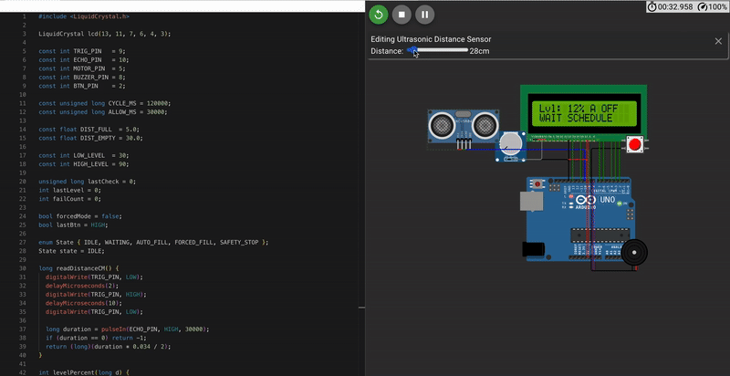

# Arduino Smart Water Tank FSM

An Arduino-based smart water-tank controller implemented as a finite-state machine (FSM).



## Overview
The system measures tank level with an ultrasonic sensor, controls a pump, displays status on a 16x2 LCD, and provides a forced-fill mode with safety detection.

## State Machine
- `IDLE` — normal monitoring
- `WAITING` — low level detected but scheduled filling is unavailable
- `AUTO_FILL` — automatic filling during the allowed schedule
- `FORCED_FILL` — manual/forced filling mode
- `SAFETY_STOP` — pump stopped after detecting a likely filling failure

## Hardware
- Arduino-compatible board
- Ultrasonic distance sensor
- 16x2 LCD
- Water pump / motor driver
- Buzzer
- Push button

## Key Concepts
- Finite-state machine design
- Ultrasonic distance measurement
- Scheduled operation windows
- Pump control
- Safety/failure detection
- LCD status reporting

## Source Code

[View the Arduino sketch](Arduino-Smart-Water-Tank-FSM/src/SmartTankSystem.ino)

## Project Structure
```text
Arduino-Smart-Water-Tank-FSM/
├── src/
│   └── SmartTankSystem.ino
└── assets/
    └── demo_preview.gif
```

## Purpose
Academic embedded-systems project demonstrating FSM-based control logic and hardware interaction.